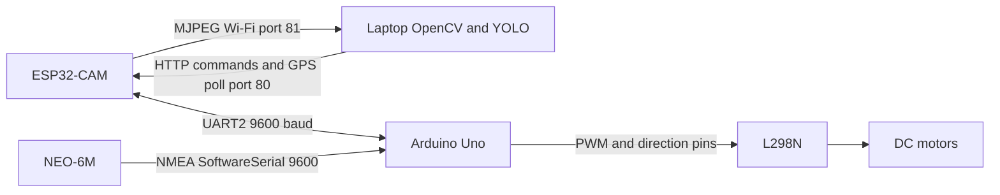

# AI-Based Smart Garbage Detection and Monitoring Robot

This prototype connects ESP32-CAM video, laptop-side YOLO segmentation, manual driving, Arduino motor control, and GPS telemetry. Garbage-specific classification, automatic collection, and detection logging are not implemented.

## Status

| Feature | Status |
|---|---|
| ESP camera AP, MJPEG stream and web endpoints | Implemented in source; hardware unverified |
| Python OpenCV stream, YOLO segmentation overlay | Implemented; model suitability for garbage is unknown |
| WASD driving, Uno motor commands and timeout stop | Implemented in source; hardware unverified |
| GPS parsing and text display | Implemented in source; hardware unverified |
| Detection events, GPS association, saved images | Not implemented |
| LoRa, cloud dashboard, autonomous collection | Planned only |

## System architecture

## Run

Install Python dependencies from the repository root with `python -m pip install -r ai-detection/requirements.txt`, then run `python ai-detection/camera.py`. Connect to the ESP access point first. Controls: W/A/S/D, Space or X to stop, Esc to exit. Keep the video window focused. Setup and wiring details are in docs/.

## Hardware and limits

ESP32-CAM serves video and HTTP endpoints. Uno runs motor control and GPS parsing. The NEO-6M provides NMEA; L298N drives the two motors. Battery design is unspecified. Never power motors from Uno GPIO or its 5 V output; see hardware guide. Physical operation has not been verified. Supplied YOLO model training and class suitability are unknown. GPS text is displayed but is not attached to detections or stored. Contributors and license were not specified.