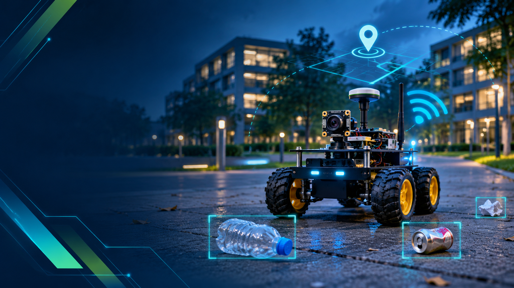
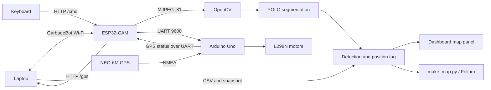
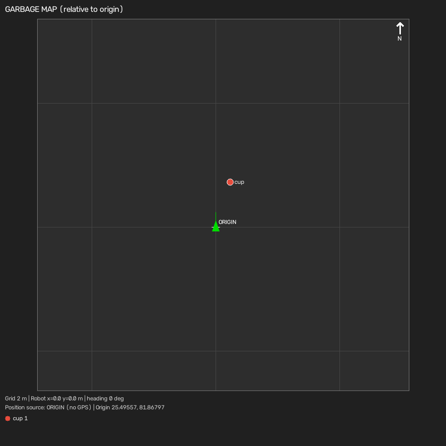
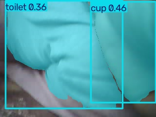

# GarbageBot

An AI based mobile robot that detects litter in ESP32-CAM video, logs estimated positions, and displays them on a live map.

[](https://www.python.org/)
[](https://docs.ultralytics.com/)
[](https://opencv.org/)
[](https://www.espressif.com/)
[](https://www.arduino.cc/)
[](LICENSE)



## What it does

GarbageBot streams video from an ESP32-CAM to a laptop, runs YOLO segmentation on the frames, and lets an operator drive the robot with the keyboard. Detections can be saved with a position estimate, CSV record, and snapshot, then viewed on the dashboard map or in a Folium map.

## Key features

- Live MJPEG camera stream with a segmentation overlay.
- Wireless WASD driving through the ESP32-CAM to an Arduino Uno.
- GPS status display using a NEO-6M GPS module.
- Detection records, snapshots, and a relative map panel.
- Folium map generation from the saved CSV log.

## How it works

1. The laptop joins the GarbageBot Wi-Fi hotspot.
2. ESP32-CAM serves an MJPEG stream on port 81 and HTTP endpoints on port 80.
3. OpenCV reads the stream and YOLO draws segmentation results.
4. Keyboard commands travel by HTTP `/cmd`, ESP32 UART, and Arduino Uno to the L298N motors.
5. NEO-6M sends GPS data to the Uno; the ESP32 exposes the latest line at `/gps` for the laptop.
6. A detection is tagged with the latest GPS fix, or an ORIGIN fallback with command-based dead reckoning, then saved to CSV with a snapshot and added to the map panel.
7. `make_map.py` renders the CSV records as an interactive Folium map.



## Dashboard and sample results

The available map image shows the generated relative map panel. The sample snapshot and CSV are sanitized project examples.



*Relative map panel generated by the camera application.*



*One saved detection image.*

<!-- Add assets/screenshots/dashboard_live.png: screenshot showing camera view, info bar, map panel and legend. -->
<!-- Add assets/screenshots/csv_log.png: screenshot of the detections CSV. -->
<!-- Add assets/screenshots/hardware_robot.jpg: photo of the assembled robot, if available. -->
<!-- Add assets/screenshots/folium_map.png: screenshot of the interactive Folium map. -->

## Hardware

| Component | Role |
|---|---|
| AI Thinker ESP32-CAM | Camera, Wi-Fi hotspot, HTTP endpoints and UART bridge |
| Arduino Uno | Motor commands, watchdog stop, and GPS parsing |
| NEO-6M | NMEA GPS receiver |
| L298N | Dual motor driver |
| DC motors and chassis | Robot movement; motors are rated 3–6 V per project notes |
| Laptop | Video inference, controls, logging, and map display |

### Wiring summary

| Link | Connections |
|---|---|
| ESP32-CAM to Uno UART | ESP GPIO14 TX → Uno D0/RX; Uno D1/TX → ESP GPIO13 RX through a resistor divider; common ground |
| NEO-6M to Uno | GPS TX → Uno D4; common ground; 9600 baud |
| Uno to L298N | D5/D8/D9 → ENA/IN1/IN2; D6/D10/D11 → ENB/IN3/IN4 |
| Power | Give the ESP32-CAM a stable 5 V supply. Keep motor power within the motor and driver ratings, and connect grounds together. Do not power motors from Uno GPIO or its 5 V pin. |

See [docs/hardware-and-wiring.md](docs/hardware-and-wiring.md) for details. The Uno D1 output is 5 V logic; protect ESP GPIO13 with the divider. Firmware and wiring have not been physically verified.

## Software setup

Prerequisites: Python 3.10 or newer, Git, Arduino IDE, ESP32 board support, an AI Thinker ESP32-CAM, and the TinyGPSPlus library for the Uno.

```bash
git clone <REPOSITORY_URL>
cd GarbageBot
python -m venv .venv
```

Activate the environment:

```powershell
.venv\Scripts\Activate.ps1
```

```bash
pip install -r requirements.txt
```

Before flashing the ESP32-CAM, copy `hardware/esp32_cam/secrets.example.h` to `hardware/esp32_cam/secrets.h` and set `AP_PASSWORD` to `<YOUR_PASSWORD>` in your local firmware file. Set your own password; do not commit it. Upload the Uno sketch with its D0/D1 serial wires disconnected. For ESP32-CAM upload, connect IO0 to GND, select upload speed 115200, flash, then remove the IO0 jumper before rebooting.

Join the `GarbageBot` Wi-Fi network, activate `.venv`, and start the laptop application:

```bash
python ai-detection/camera.py
```

The ESP32-CAM is expected at `192.168.4.1`. The camera stream supports one viewer, so close the ESP web page before running the Python application.

## Controls

| Key | Action |
|---|---|
| W / A / S / D | Forward / left / backward / right |
| Space / X | Stop |
| L | Toggle detection logging |
| O | Set the current GPS fix as the map origin |
| M | Save the current map panel as `ai-detection/detections/map_latest.png` |
| Esc | Exit and stop the robot |

Movement is sent as forward, backward, left, and right commands while keys are held. Space or X stops movement. The keyboard listener requires the application window to be focused for L, O, and M.

## Data format

`ai-detection/detections/detections.csv` contains these columns:

`timestamp`, `robot_id`, `garbage_type`, `confidence`, `latitude`, `longitude`, `satellites`, `gps_source`, `garbage_lat`, `garbage_lng`, `garbage_x_m`, `garbage_y_m`, `distance_m`, `bearing_deg`, `area_px`, `area_percent`, `size_class`, `area_cm2`, `bbox_w_px`, `bbox_h_px`, `snapshot`.

`gps_source=FIX` indicates a current GPS fix. `gps_source=ORIGIN` indicates the configured origin and dead-reckoning estimate are being used because there is no usable fix. Object distance and bearing are estimates from camera geometry and drive commands.

## Model training

The preparation script downloads annotations and images from the [TACO dataset](https://tacodataset.org/), which is released under [CC BY 4.0](https://creativecommons.org/licenses/by/4.0/). The default grouped labels are Bottle, Cap/Lid, Can, Carton, Cup, Paper, Plastic bag/wrapper, Plastic container, Cigarette, and Other litter.

From the repository root, prepare the dataset and train:

```bash
python ai-detection/prepare_taco.py
python ai-detection/train_taco.py
```

The trained weights are written to `ai-detection/models/garbage-seg.pt`. The camera application uses them when present; otherwise it falls back to `ai-detection/models/yolo11n-seg.pt`, a generic COCO model. Training results have not been measured for this repository.

## Calibration

| Setting | Purpose |
|---|---|
| `ROBOT_SPEED_MPS` | Estimated travel speed for dead reckoning |
| `TURN_RATE_DPS` | Estimated turn rate |
| `NEAR_DIST_M`, `FAR_DIST_M` | Camera-based object distance range |
| `CAMERA_HFOV_DEG` | Camera horizontal field of view |
| `ORIGIN_LAT`, `ORIGIN_LNG` | Fallback map origin |

These settings are in `ai-detection/camera.py`. Calibrate them against the actual robot and camera mounting before relying on mapped positions.

## Current status and limitations

The source implements live video, keyboard driving, detection logging, snapshots, and a garbage map panel. Physical operation has not been verified. The TACO model must be trained separately; until `garbage-seg.pt` exists, the generic COCO model is used and its garbage suitability is limited.

| Metric | Result |
|---|---|
| Box mAP50 | TBD |
| Box mAP50–95 | TBD |
| Mask mAP50 | TBD |
| Mask mAP50–95 | TBD |

GPS needs open sky for a fix. Without one, the configured ORIGIN fallback is used. GPS accuracy is typically a few metres. Garbage positions are estimates: there is no compass or wheel encoder, and heading and distance come from drive commands and camera geometry.

## Roadmap

- Add LoRa SX1262 telemetry.
- Add obstacle avoidance.
- Add battery monitoring.
- Collect and evaluate a project-specific dataset.
- Build a dashboard for reviewing robot runs and detections.

## Troubleshooting

| Symptom | Check |
|---|---|
| Wi-Fi hotspot missing | ESP32-CAM power, firmware, and local `secrets.h` configuration |
| Stream is blank | AI Thinker board selection, camera initialization, power, and single-viewer limit |
| Laptop cannot connect | Join the GarbageBot hotspot and check `192.168.4.1:81/stream` |
| Model not found | Keep weights under `ai-detection/models/` |
| GPS has no fix | Test outdoors with open sky and allow acquisition time |
| Motors do not move | Check motor supply, L298N wiring, common ground, UART, and upload wiring |

See [docs/troubleshooting.md](docs/troubleshooting.md) for additional checks.

## Project structure

```text
GarbageBot/
├── README.md
├── LICENSE
├── .gitignore
├── requirements.txt
├── ai-detection/
│   ├── camera.py
│   ├── make_map.py
│   ├── prepare_taco.py
│   ├── train_taco.py
│   └── models/
├── hardware/
│   ├── arduino_uno/arduino_uno.ino
│   └── esp32_cam/esp32_cam.ino
├── docs/
│   └── diagrams/
└── assets/
    ├── sample/
    ├── screenshots/
    └── project-images/
```

## Team

- [Team member name]
- [Team member name]

## License

Released under the MIT License. See [LICENSE](LICENSE).

## Acknowledgements

- [TACO dataset](https://tacodataset.org/) for litter annotations and images.
- [Ultralytics](https://www.ultralytics.com/) for YOLO.
- [TinyGPSPlus](https://github.com/mikalhart/TinyGPSPlus) for GPS parsing.
