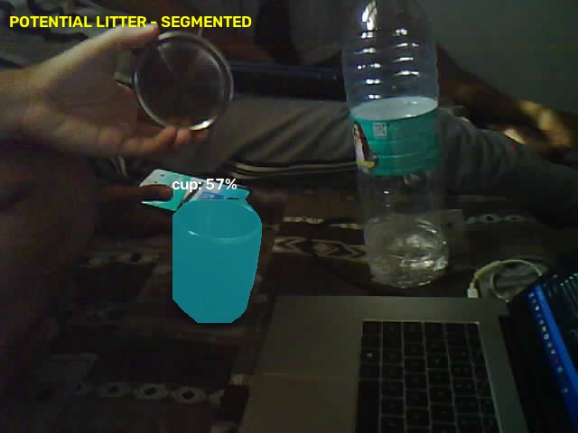

# ESP32-CAM garbage segmentation

This project detects potential litter from an ESP32-CAM video stream. The
ESP32-CAM creates its own Wi-Fi network and serves an MJPEG stream. The Python
application reads that stream, uses a YOLO segmentation model to identify
**bottles** and **cups**, displays coloured instance masks, and saves an alert
image for each detected class at most once every 10 seconds.



## Repository contents

- `esp32_cam_streamer/esp32_cam_streamer.ino` - firmware for an AI-Thinker
  ESP32-CAM. It starts the `GarbageRobot` access point and an MJPEG endpoint.
- `main.py` - desktop-side detector and viewer.
- `examples/segmentation/` - sample output images.

Model weights, local Python environments, and runtime output are intentionally
not committed.

## Hardware and software needed

- An AI-Thinker ESP32-CAM, an FTDI/USB-to-serial programmer, and a stable 5 V
  power source.
- Arduino IDE with the Espressif ESP32 board package installed.
- A computer with Python 3.9+ and Wi-Fi.

## 1. Flash the ESP32-CAM

1. Open `esp32_cam_streamer/esp32_cam_streamer.ino` in Arduino IDE.
2. In **Tools > Board**, select **AI Thinker ESP32-CAM**. Use the appropriate
   serial port and a 115200 baud upload speed.
3. Connect `GPIO 0` to `GND`, upload the sketch, then disconnect `GPIO 0` from
   `GND` and reset the board to run it.
4. Open Serial Monitor at 115200 baud. The camera should report its stream URL:
   `http://192.168.4.1:81/stream`.
5. Before flashing, set `password` in the sketch to a private value of at
   least eight characters. Then connect the computer that will run Python to
   the Wi-Fi network:

   ```text
   Network: GarbageRobot
   Password: the password you configured in the sketch
   ```

You can first open the stream URL in a browser to confirm that the camera is
working.

## 2. Run segmentation

From the repository root, create and activate a virtual environment (optional
but recommended), install dependencies, then start the application:

```powershell
python -m venv .venv
.\.venv\Scripts\Activate.ps1
python -m pip install --upgrade pip
pip install ultralytics opencv-python
python main.py
```

On first use, Ultralytics downloads `yolo11n-seg.pt` automatically if it is not
already present. The weight file is ignored by Git and is never pushed.

The live window shows coloured segmentation masks and labels. Press `q` to quit.
Alert frames are saved locally in `segmentation_results/` and are also ignored
by Git.

## Configuration

- Change `ssid` and `password` in the Arduino sketch to use a different camera
  access-point name or password.
- Change `camera_url` in `main.py` if the stream address or port changes.
- `classes=[39, 41]` limits detection to COCO bottle and cup classes.
- `conf=0.45` controls the minimum confidence threshold.

## Troubleshooting

- If the Python app cannot connect, verify the computer is connected to
  `GarbageRobot` rather than another Wi-Fi network, then test the stream URL in
  a browser.
- If the camera repeatedly resets or fails to initialize, use a stable 5 V
  supply capable of powering the ESP32-CAM.
- If upload fails, check that GPIO 0 was grounded only during upload and that
  it was disconnected before resetting the board.
