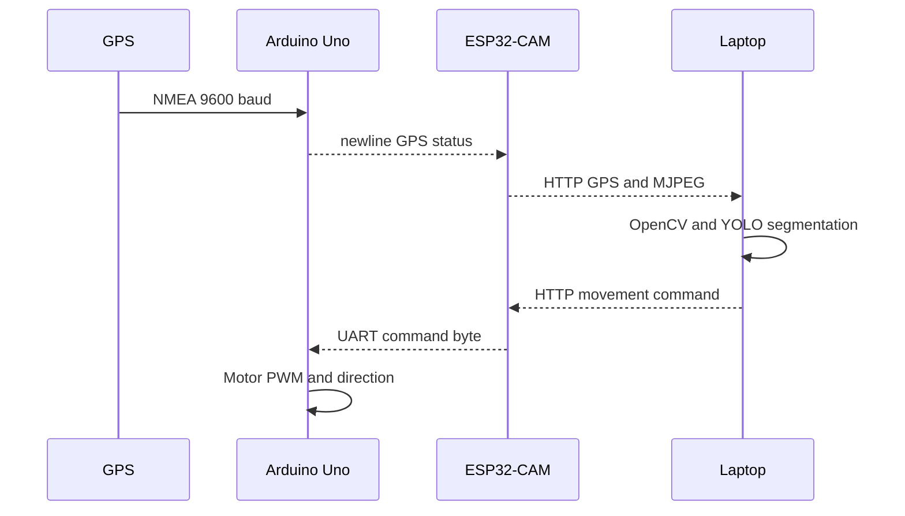

# System architecture

## Implemented flow

1. ESP32-CAM initializes its AI Thinker camera pin map and creates a Wi-Fi AP. The page and GPS endpoint use TCP 80; multipart JPEG video uses TCP 81.
2. Laptop Python captures video with OpenCV and runs Ultralytics segmentation on recent frames.
3. Keyboard state is sent as HTTP GET /cmd?c=F, B, L, R, S, or a speed digit. ESP validates the first character and relays it over UART2.
4. Uno receives command bytes at 9600 baud and drives the L298N. It stops after one second without a valid command.
5. Uno parses GPS NMEA on SoftwareSerial at 9600 baud and periodically emits a newline-terminated status line. ESP serves the newest line at /gps.
6. Python displays GPS text with the video. It does not save detections or GPS logs.

## Interfaces

| Link | Details |
|---|---|
| Laptop to ESP | HTTP port 80: /cmd and /gps |
| ESP to laptop | MJPEG at port 81 /stream |
| ESP UART2 to Uno | 9600 baud, 8N1; ESP RX GPIO13, TX GPIO14 |
| GPS to Uno | NMEA; GPS TX to Uno D4, SoftwareSerial 9600 |
| Uno to L298N | ENA D5, IN1 D8, IN2 D9, ENB D6, IN3 D10, IN4 D11 |

GPS status formats: GPS,latitude,longitude,satellites; GPS,NO_FIX,SAT=count; GPS,NO_DATA,CHECK_WIRING. LoRa and cloud links are not implemented.

