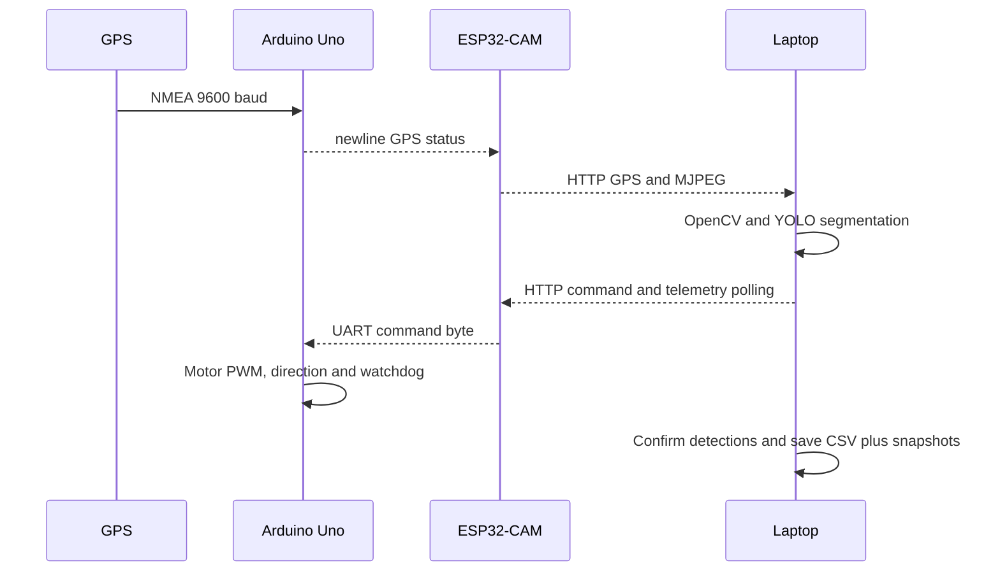

# System architecture

## Implemented flow

1. ESP32-CAM initializes the AI Thinker camera and a Wi-Fi access point. HTTP uses port 80; multipart JPEG video uses port 81.
2. Laptop Python captures video with OpenCV and runs Ultralytics segmentation on recent frames.
3. Keyboard commands travel through HTTP `/cmd` and ESP UART2 to the Uno. Speed digits configure motor PWM; `/res` changes camera resolution.
4. Uno parses commands and drives the L298N. A command watchdog stops the motors after 1.5 seconds. Startup also runs a brief forward/reverse motor test.
5. Uno parses GPS NMEA and periodically emits a newline-terminated status line. The ESP exposes the latest line through `/gps` and in `/cmd` responses.
6. Python smooths hardware GPS updates, holds the last fix briefly after link loss, or can create an explicitly assisted software position for indoor demonstrations. Without a hardware fix, command-based dead reckoning is used.
7. YOLO detections are confirmed across multiple frames, deduplicated spatially, and optionally written to CSV with annotated snapshots. The live panel and `make_map.py` display mapped detections.

## Interfaces

| Link | Details |
|---|---|
| Laptop to ESP | HTTP port 80: `/`, `/cmd`, `/gps`, `/res` |
| ESP to laptop | MJPEG at port 81 /stream |
| ESP UART2 to Uno | 9600 baud, 8N1; ESP RX GPIO13, TX GPIO14 |
| GPS to Uno | NMEA; GPS TX to Uno D4, SoftwareSerial 9600 |
| Uno to L298N | ENA D5, IN1 D8, IN2 D9, ENB D6, IN3 D10, IN4 D11 |

GPS status formats: `GPS,latitude,longitude,satellites,hdop`; `GPS,NO_FIX,SAT=count`; `GPS,NO_DATA,CHECK_WIRING`. LoRa and cloud links are not implemented.

